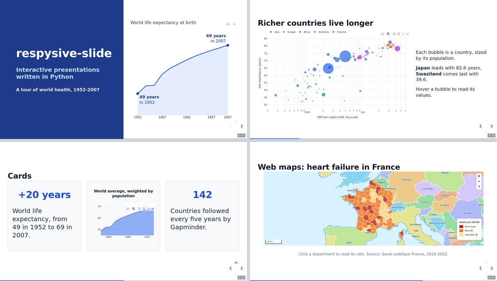

# respysive-slide

[](https://pypi.org/project/respysive-slide/)
[](https://github.com/fbxyz/respysive-slide/actions/workflows/ci.yml)
[](https://fbxyz.github.io/respysive-slide/)

Interactive HTML presentations written in Python. Slides take text, Markdown,
LaTeX, images, Plotly, Altair and Matplotlib charts, and maps, laid out on a
Bootstrap grid. A deck is a single HTML file that opens in any browser, and it
exports to PDF and to PowerPoint with editable text and charts.

[](https://fbxyz.github.io/respysive-slide/showcase.html)

**[See the showcase deck](https://fbxyz.github.io/respysive-slide/showcase.html)**, made with
[this script](https://github.com/fbxyz/respysive-slide/blob/master/docs/examples/showcase.py) ·
[Documentation](https://fbxyz.github.io/respysive-slide/) ·
[Gallery](https://fbxyz.github.io/respysive-slide/gallery/index.html) ·
[Changelog](https://github.com/fbxyz/respysive-slide/blob/master/CHANGELOG.md)

## Installation

```
pip install respysive-slide
```

PDF and PowerPoint exports render the slides with headless Chromium:

```
pip install "respysive-slide[pptx]"
python -m playwright install chromium
```

respysive-slide requires Python 3.10 or later.

## Example

```python
import plotly.express as px
from respysive import Presentation, Slide

df = px.data.gapminder().query("year == 2007")
fig = px.scatter(df, x="gdpPercap", y="lifeExp", size="pop", color="continent",
                 hover_name="country", log_x=True, size_max=45)

title = Slide(center=True)
title.add_title_page({"title": "World health", "subtitle": "Gapminder data, 2007"})

chart = Slide()
chart.add_title("Life expectancy and income")
chart.add_content([fig, "Each bubble is a country, sized by its population."], columns=[8, 4])
chart.add_notes("Start with the cluster of African countries on the left.")

deck = Presentation()
deck.add_slide([title, chart])
deck.save_html("world_health.html", theme="sober")
deck.save_pdf("world_health.pdf", theme="sober")
deck.save_pptx("world_health.pptx", theme="sober")
```

Open `world_health.html` in a browser: the arrow keys move between slides and `S`
opens the speaker view.

## Features

- **Content**: `add_content` detects the type of each item (Markdown, HTML, LaTeX,
  images, videos, Plotly, Altair, Matplotlib, pandas tables) and places the items
  side by side. Cards, title pages, and nested layouts with `Row` and `Column`.
- **Maps**: MapLibre web maps (markers, proportional circles, flows, choropleths)
  without writing JavaScript. Thematic maps drawn in Python with mappyng are also
  supported; mappyng 2 will be published soon.
- **Presenting**: fragments, vertical slides, speaker view with notes, overview,
  touch navigation.
- **Fitting**: slides have a fixed size, and content taller than the slide is
  fitted to it. `check()` reports the slides whose text became too small.
- **Themes**: `sober`, `science` and `corporate`, which also colour the charts.
  Reveal.js themes and custom CSS work too.
- **Exports**: PDF with vector text and charts, PowerPoint with editable text and
  native charts for simple Plotly figures, and offline HTML files that embed every
  library.

## Upgrading from version 1

Most scripts run unchanged. The
[migration guide](https://fbxyz.github.io/respysive-slide/migration/v1_to_v2.html)
lists what differs.

## License

MIT
